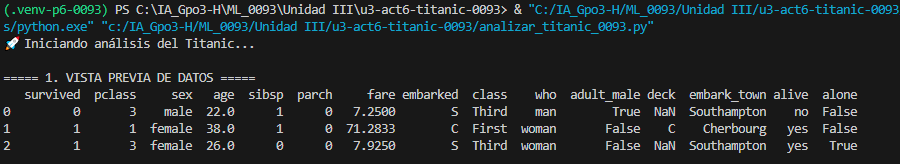
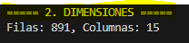
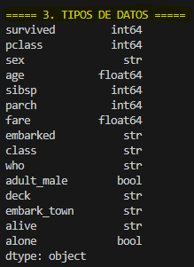
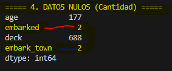
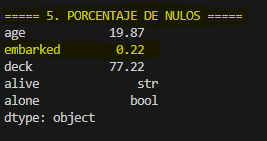
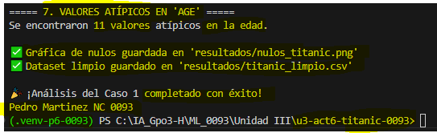

# 🕵️‍♂️ Práctica: Identificación de Problemas en los Datos

> **⏱️ Duración:** 2 horas  
> **🎯 Nivel:** Cero a principiante  
> **🤖 Área:** Machine Learning (Data Cleaning)  
> **💻 Herramientas:** Python, VS Code, Pandas, NumPy, Seaborn  
## Pedro Ramses Martinez Fuentes NC.0093
## 🎯 Propósito de la Práctica
Que los estudiantes aprendan a revisar conjuntos de datos (*datasets*) e identifiquen los problemas más comunes que pueden arruinar el entrenamiento de un modelo de Machine Learning. 

Trabajaremos con dos escenarios reales:
1. **Caso 1: Pasajeros del Titanic** 🚢 (Detección de problemas reales: nulos, duplicados, tipos y atípicos).

## 1. VISTA PREVIA DE DATOS 0093

## 2. DIMENSIONES 0093

## 3.TIPOS DE DATOS 0093

## 4. DATOS NULOS (Cantidad) 0093

## 5. PORCENTAJE DE NULOS 0093

## 6.REGISTROS DUPLICADOS 0093

## 7. VALORES ATÍPICOS EN 'AGE'

# IMAGEN GENERADA 0093
